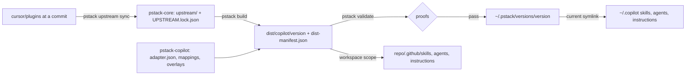

# Architecture

## Contracts

Each component talks to the next through files. Their parsers in pstack-manager reject unknown shapes, so a format change fails loudly.

### `pstack-core/UPSTREAM.lock.json`

| Field | Meaning |
| --- | --- |
| `repository`, `path`, `ref` | Where the copy came from. |
| `commit`, `committedAt`, `tree` | The exact upstream commit and the git tree hash of `pstack/` at it. |
| `name`, `version` | From upstream's `plugin.json`. |
| `license` | SPDX id and copyright holder read from upstream's `LICENSE`. |
| `vocabulary` | The `TERMS` list and route key from upstream's harness generator at the same commit: the Cursor names upstream itself considers platform-specific. |
| `files` | sha256, size, and mode of every file. |

### `pstack-<platform>/adapter.json`

The platform adapter's spec. It names supported core versions and a revision, path relocations and exclusions, the agent mapping, the adapter line, the vocabulary extras, the frontmatter additions, model rules, the traceability file, overlays, and the install layout. The transforms it can ask for are a closed set implemented by the manager (see [pstack-copilot/README.md](../pstack-copilot/README.md#transforms-the-build-may-apply)). An adapter cannot run code.

### `dist-manifest.json`

One entry per shipped file: path, origin (`core`, `overlay`, `generated`), source path and sha256, output sha256 and mode, and the ordered transforms with what each needs to be undone (link rewrites, insertion offsets, agent frontmatter changes). It also records the core commit and the install layout, so every stored version describes itself.

### `~/.pstack/state.json`

Active version, version history for rollback, and the exact symlinks pstack created. Uninstall and update touch only those.

## Flows

- **Sync.** Fetch a sparse, shallow checkout at a ref. Compute the lock. Diff it against the current lock. Copy to a staging folder and verify the copy. Gate it: build and validate the adapter against the staged core in a scratch folder. If anything fails, discard the staging folder and report. Otherwise swap it in, write the lock, and prepend the changelog.
- **Build.** Walk the core and map each path (relocate, exclude, agent). Rewrite links, classify each skill folder with the vocabulary, inject the adapter line, add frontmatter, and render agents. Copy overlays, generate `plugin.json` and the matrix, then write the manifest. Same inputs, same bytes.
- **Install (user).** Build and validate. Store the version under `~/.pstack/versions/` (immutable). Swap `current` atomically, then sync the symlinks in `~/.copilot` to the version's layout.
- **Update.** Sync with the gate, then install. A blocked sync installs nothing.
- **Rollback.** Swap `current` to a stored version and sync the symlinks.
- **Install (workspace).** Copy into `.github/`. Record each file's sha256 in `.github/pstack-install.json`. Later installs replace only files whose bytes still match that record.

## Why links resolve in every layout

Every pstack skill reaches its siblings as `../<name>/SKILL.md`, and Copilot reports a skill's path as the path it loaded it from. pstack-manager therefore keeps all skills, including the adapter skill and the relocated upstream docs (`skills/pstack-copilot/upstream/`), side by side in one folder. That folder is `~/.copilot/skills/` (symlinks), `.github/skills/` (copies), or a plugin's `skills/`. A VS Code probe confirmed that a skill loaded through a symlinked folder reads its sibling through the symlinked path.

## Adding another platform

See [adding-a-platform.md](adding-a-platform.md). The core does not change.
