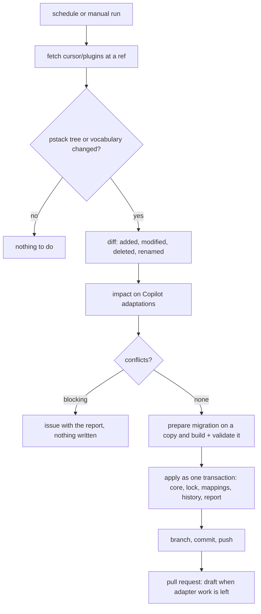

# Upstream synchronization

pstack changes often. This repository follows [cursor/plugins](https://github.com/cursor/plugins), folder `pstack/`, with a daily GitHub Actions job. When pstack changed, the job opens a pull request that holds the exact new upstream copy, the Copilot migration it could prepare, and a report of everything it found. A person reviews and merges. Nothing merges by itself.



## Run it

| How | What happens |
| --- | --- |
| Every day at 05:17 UTC | `.github/workflows/upstream-sync.yml` runs `pstack upstream check`. If pstack changed, it runs `pstack upstream run`. |
| Manually | Actions, **upstream-sync**, **Run workflow**. Inputs: `ref` (branch, tag, or commit, default `main`), `dry_run` (report only), `include_rolled_back`, `allow_downgrade`. |
| Locally | `pstack upstream check` analyzes and writes nothing. `pstack upstream sync` updates the working tree. `pstack upstream run` also opens the pull request. |

Set up the repository once:

1. Settings, Actions, General: allow GitHub Actions to create pull requests.
2. Optional: add a `PSTACK_SYNC_TOKEN` secret, a fine-grained token with contents, pull requests, and issues write access. Pull requests opened with the default token do not start other workflows, so without the secret `ci.yml` does not run on sync pull requests. The sync job runs the full compatibility checks itself and puts the result in the report either way.
3. Require a review on `main` with branch protection. The workflows never merge, approve, or enable auto-merge.

## What a run does

1. **Fetch.** A sparse, shallow checkout of `pstack/` at the ref, plus enough history (`--shallow-since`) to read the commits since the locked one. It records the upstream commit, tree hash, version, and the Cursor vocabulary from upstream's own harness generator.
2. **Detect changes.** Added, modified, deleted, renamed, and mode-changed files. A deleted and an added file with the same bytes are one rename. Text files that moved and changed count as a rename when at least 60% of their lines match. The changes are also grouped by skill, playbook, agent, script, and automation.
3. **Skip when nothing changed.** Most upstream commits do not touch `pstack/`. If the tree and the vocabulary are the same, nothing is proposed.
4. **Analyze the impact.** See below.
5. **Detect conflicts.** See below. A blocking conflict stops the run before anything is written.
6. **Prepare the migration** and **run the compatibility checks** on a scratch copy of the adapter, against the staged core. These are the checks of `pstack validate`: the core is exact, the build is the core plus declared transforms, every Cursor name in use has an adapter row, every upstream feature is traced, the Copilot schemas and links hold, and, with `--scripts` (the workflow passes it), upstream's own script tests pass on the build.
7. **Apply as one transaction**: the new `pstack-core/upstream/`, the lock, the changelog, the migrated mapping files, the regenerated compatibility matrix, the history, and the report. If any step fails, every file goes back as it was.
8. **Open the pull request** on branch `sync/upstream-<commit>`, with the report as its body. It is a draft, labeled `needs-adapter-work`, when a check still fails. Labels: `upstream-sync`.

Re-running for the same upstream commit updates the same pull request. A pull request for an older upstream commit gets a comment pointing at the newer one. The job never closes anything.

## Impact on the Copilot adaptation

Each affected adaptation is classified by who handles it:

| Action | Meaning |
| --- | --- |
| **automatic** | The build derives it again from the new core: relocated paths, rewritten links, the adapter line on files that now use, or stop using, a Cursor name. |
| **migrated** | The sync prepares the change in mapping data. A reviewer checks the diff. |
| **review** | Upstream changed something the adaptation depends on. The Copilot side may still be right. A human reads the change. |
| **manual** | Custom Copilot work needs a human. The sync never edits it. |

What the analysis looks at:

- **Items.** A new, deleted, renamed, or modified skill, playbook, agent, script, or automation against `features.json`, `agents.json`, and `skills.json`. A modified item with a Copilot adaptation is listed for review. A modified item that a VS Code run validated is marked stale.
- **Cursor names.** For every skill and agent, which names it used before and after, using upstream's classifier. A Cursor name with no row in the adapter skill is **manual**.
- **References.** Overlays and mappings that mention an upstream file the sync found deleted or renamed.
- **Watch rules.** `adapter.json` lists the upstream files each adaptation derives from, for example `docs/harness/claude-code.md` for the adapter skill and `skills/setup-pstack/SKILL.md` for the model defaults. A change to a watched file lists its dependent adaptations. Deleting or renaming one makes them **manual**. Add a rule whenever a custom adaptation starts to depend on an upstream file.

## The migration

The sync edits only `adapter.json` (supported core version, revision), `mappings/features.json`, `mappings/agents.json`, and `mappings/skills.json`, and regenerates `docs/COMPATIBILITY.md`. It never edits overlays, `terms.json`, `models.json`, the adapter skill, the poteto-mode agent, the instruction, or the docs. A check in the code refuses any write outside that list.

| Upstream change | Migration |
| --- | --- |
| New skill, playbook, script, automation, or Cursor term | A `pending` entry in `features.json`: "New in upstream X. Not reviewed for Copilot yet." |
| New agent | A rule in `agents.json` derived from its frontmatter: it drops every key but `name` and `description`, maps a Cursor model slug through `models.json`, and hides the agent as a delegate. |
| Deleted item | The entry, agent rule, or argument-hint is removed. |
| Renamed item | The entry, rule, or hint is renamed and keeps its content. |
| Modified item that a VS Code run validated | `validation` becomes `stale`, with a note. The evidence stays. |
| Upstream now sets a frontmatter key that `skills.json` adds | The Copilot hint is dropped, so upstream's value wins. |
| Any sync | `coreVersions` becomes the new version and `revision` goes up, so an installed build never changes under its version. |

An entry or rule that already exists is kept as it is and listed in the report. Anything the sync cannot decide, such as a Cursor name without a row in the adapter skill, is listed under **What a human has to do** and fails the checks, which makes the pull request a draft.

## Conflicts

| Conflict | Blocking | Override |
| --- | --- | --- |
| `core-modified`: `pstack-core/upstream` no longer matches the lock | yes | none. Restore it with git. |
| `uncommitted-changes` in `pstack-core`, `pstack-copilot`, or `docs/sync` | yes | none. Commit or stash. |
| `overlay-collision`: a new upstream file would land on a path a custom Copilot file provides | yes | none. Rename the overlay or map the upstream path elsewhere. |
| `history-diverged`: the locked commit is not an ancestor of the new one | yes | `--allow-rewrite` |
| `version-downgrade` | yes | `--allow-downgrade` |
| `previously-rolled-back`: a reviewer rolled this upstream state back | yes | `--include-rolled-back` |
| `history-unknown`, `same-version-new-content`, `unmapped-path`, `frontmatter-collision` | warning | |

When a conflict blocks a scheduled run, the job opens one issue labeled `sync-conflict` with the report, and does not repeat it while that issue is open.

## History and reports

- `docs/sync/history.json` is an append-only record: for each sync its id, trigger, status (`prepared`, `needs-adapter-work`, `rolled-back`), the upstream commit, tree, and version before and after, file counts, adapter revision, conflicts, migration steps, failed checks, and report path. A rollback adds its own entry and marks the sync `rolled-back`. `pstack upstream history` prints it.
- `docs/sync/reports/<date>-<version>-<commit>.md` is the report that is also the pull request body, and `.json` is the same data for tools. The report has the summary, conflicts, what a human has to do, the changed files with renames, the changed items, the Cursor vocabulary, the upstream commits, the impact by action, the migration, the check results, and how to roll back.
- `pstack-core/UPSTREAM.lock.json` holds the exact upstream state, and `CHANGELOG.upstream.md` a short entry per sync.

## Roll back

Before the merge, close the pull request. After it:

```sh
pstack upstream rollback --dry-run       # what it would revert
pstack upstream rollback --commit        # revert and commit
pstack upstream rollback --pr            # revert and open a pull request (the upstream-rollback workflow does this)
```

The rollback finds the commit the sync arrived in by its lock transition (from the old upstream commit to the new one) and reverts it with git. That restores the core, lock, mappings, and matrix together. The history marks the sync `rolled-back` and that upstream state is not proposed again until upstream moves on. Before it keeps the result, the rollback validates the restored state.

- Only the newest sync can be rolled back, because older ones sit under it.
- A revert that collides with later changes, for example a Copilot-side edit to the same mapping file, stops and lists the files. Nothing changes and your later work stays.
- If the restored state fails validation, nothing changes either.

To roll back an installed build instead, use `pstack rollback`.

## What was tested

`tests/manager/sync.test.ts` runs the real CLI against a fixture upstream that evolves, a real git repository with a bare remote, and a fake `gh`. It covers:

- Detecting added, modified, deleted, exact-renamed, edited-renamed, and mode-changed files.
- The whole sync and its migration.
- A blocked sync that writes nothing, and a prepared one with adapter work left.
- Every blocking conflict.
- Pull request creation without touching the base branch, and updating the same pull request on a second run.
- Draft pull requests, and an issue instead of a pull request for a conflict.
- Rollback with git, and a rollback that stops on a conflict.
- The transaction restoring every file.

`tests/invariants/workflows.test.ts` checks the workflows: daily and manual triggers, minimal permissions, and no merge, auto-merge, or approval anywhere.

Against the real `cursor/plugins`, in a scratch copy of this repository: the commit of 2026-10-27 (pstack 0.15.36) was synced, and then the analysis, the sync, the checks, and a rollback ran from there to today's 0.15.48. The report listed the seven real upstream commits, the new `reframe` skill, and the deleted `orchestrate` playbook and `check-plan.mjs` script. The sync produced a valid build, and the rollback restored 0.15.36 byte for byte. That run exposed two defects in the first version, which were fixed and covered by tests: a false `history-diverged` in partial clones, and a rollback that picked the wrong commit when an upstream state had been locked twice.

## Limits

- **Not run on GitHub.** The workflows are validated as YAML and by the invariant tests. No hosted run happened and `gh` was not available here, so pull request and issue creation were exercised against a fake `gh` and real git. The first hosted run may need the repository settings above.
- **The impact analysis is textual.** It matches paths, names, and watch rules. It cannot tell whether a changed sentence in a playbook invalidates a Copilot mapping. That is what **review** is for.
- **The migration prepares bookkeeping, not behavior.** A new skill gets a `pending` entry, not an adaptation. A new Cursor name needs a human to write its row.
- **VS Code validations go stale by item, not by effect.** Any change to a validated item marks it stale, even a typo fix.
- **Renames are heuristic.** The 60% line threshold can miss a heavy rewrite or pair two similar small files.
- **Upstream history is read best effort.** If it cannot be read back to the locked commit, the report says so and a rewritten history would go unnoticed.
- **One adapter.** The gate builds the Copilot adapter. A future platform adapter needs its own gate step.
- **The first sync has no analysis.** There is nothing to compare it with.
